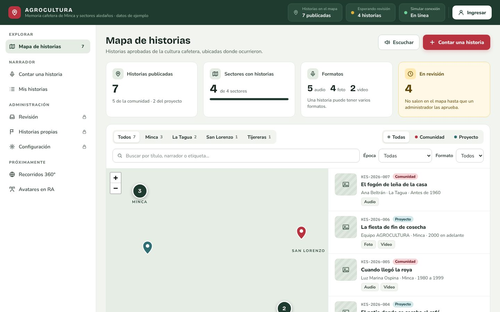
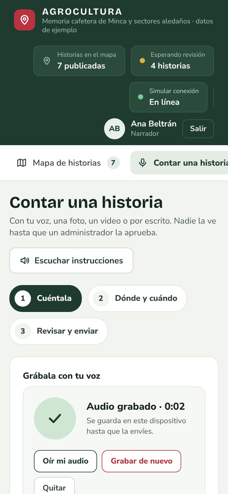
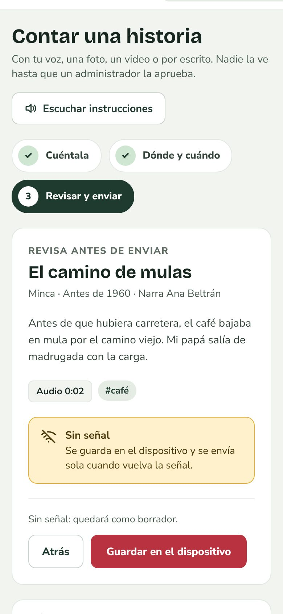
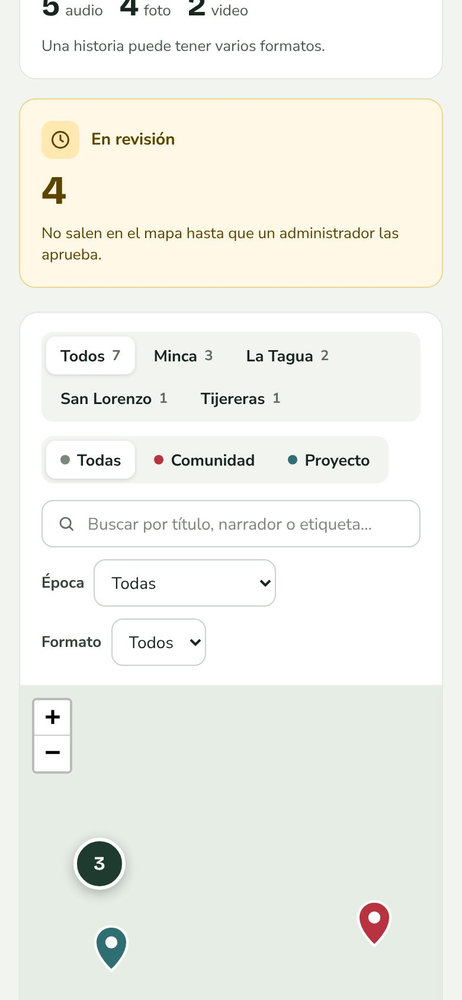
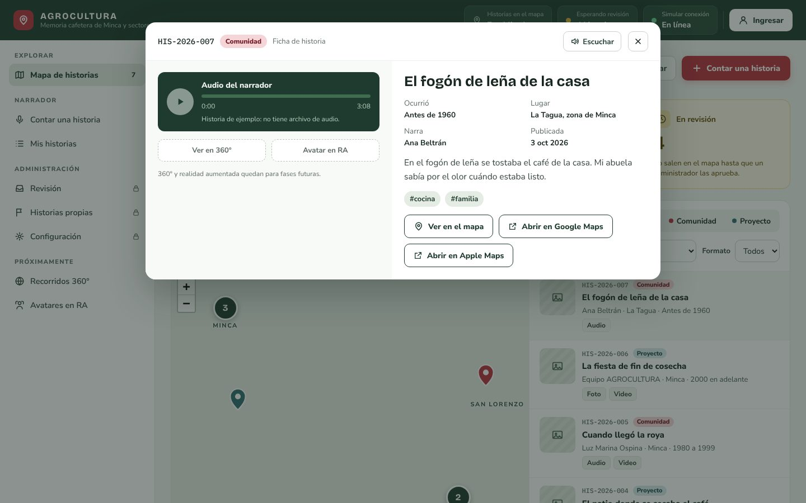
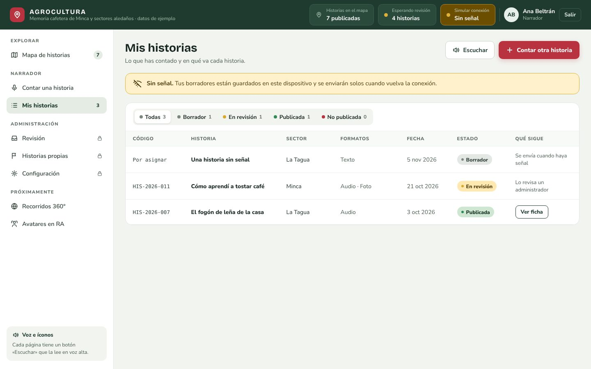
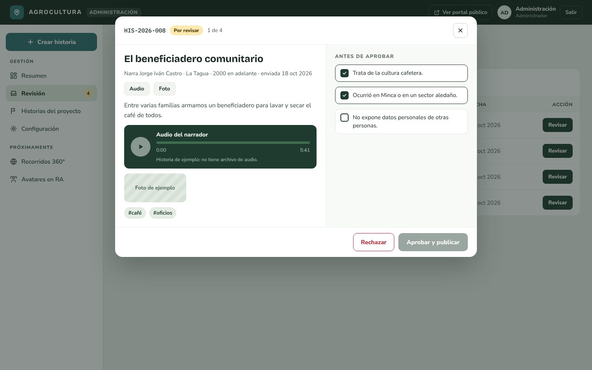

# AGROCULTURA

**Memoria viva de la cultura cafetera de Minca y sus alrededores.**

AGROCULTURA es una plataforma web donde las familias cafeteras de **Minca y sectores cercanos** (La Tagua, San Lorenzo y
Tijereras) cuentan sus historias —con su voz, fotos, video o por escrito— y las dejan guardadas sobre un **mapa**, para que no se
pierdan y cualquiera pueda explorarlas. Cada historia la revisa una persona del equipo antes de publicarse.

Se usa desde el celular, está pensada para quien no está acostumbrado a las pantallas (todo se puede escuchar y los pasos son pocos
y grandes) y **sigue funcionando cuando no hay señal en la finca**: lo que se cuenta se guarda en el teléfono y se envía solo al volver
la conexión.

Proyecto del curso Diseño y Prototipado (Ingeniería de Sistemas, Universidad del Magdalena). Equipo Protopía: Jeison, Victor y
Marleidys. Referencia: [La Piragua](https://lapiragua.com.co).

El mapa de historias, con los contadores, los filtros y la lista de la zona que se ve. El fondo del mapa (OpenStreetMap) no sale en
esta captura porque se tomó sin acceso a internet; en la plataforma real se ve el mapa de la zona detrás de los pines.

## ¿Quién la usa y qué puede hacer?

| Quién | Qué puede hacer |
|---|---|
| **Cualquier persona** (sin cuenta) | Explorar el **mapa** de historias publicadas; filtrarlas por sector, origen, época y formato; **buscarlas** por título, narrador, lugar o etiqueta; abrir la **ficha** de una historia (escucharla, ver sus fotos y su video, leer su texto, ver su lugar aproximado si lo tiene) y compartir el enlace. Todo se puede **escuchar en voz alta** con el botón «Escuchar». |
| **Las familias** (narradores) | Crear su cuenta con solo un **nombre de usuario y una contraseña** (la que quieran, de 6 caracteres o más; sin correo ni celular). **Contar una historia** en tres pasos: contarla (grabando su voz, escribiéndola, con fotos y un video), decir dónde y cuándo ocurrió (con **lugar aproximado o sin ubicación**), y revisar y enviar, donde pueden **publicarla sin su nombre** y **autorizar** que se publique (obligatorio). Ver en **«Mis historias»** en qué va cada una: borrador, en revisión, publicada, o no publicada con el motivo. Usarla **sin señal**. |
| **El equipo** (administradores) | **Revisar** cada historia que llega (leerla, oírla, verla), confirmar tres cosas y **aprobarla** o **rechazarla con un motivo**. **Publicar historias del proyecto** (las que el propio equipo ha recogido, marcadas como «Proyecto»). Ver un **resumen** de lo que hay. Configurar el nombre del portal y las etiquetas. |

## El recorrido de una historia

1. **Una familia crea su cuenta** con un nombre de usuario y una contraseña (en «Ingresar», con «¿No tienes cuenta? Crea una»). El nombre de usuario es también el nombre que se verá en sus historias. Después entra con el mismo formulario de **usuario y contraseña** que usa todo el mundo.
2. **Cuenta su historia** en tres pasos: *Cuéntala* (con su voz, escribiéndola, con fotos y un video), *Dónde y cuándo* (un título, elegir
   entre **lugar aproximado** —tocar el mapa o usar el GPS del teléfono— o **sin ubicación**, la época y, si quiere, el nombre de su finca o marca)
   y *Revisar y enviar* (donde puede **publicarla sin su nombre** y **marca la autorización** para publicarla, sin la cual no se envía).
3. **Si no hay señal**, el último botón dice «Guardar en el dispositivo»: la historia queda como borrador en el teléfono y **se envía sola**
   cuando vuelve la conexión. Si se cierra la página a medias, la historia vuelve donde se dejó.
4. La historia queda **«en revisión»**: nadie más la ve todavía.
5. **Una persona del equipo la revisa**: la lee, la escucha, mira sus fotos y confirma que *trata de la cultura cafetera*, que *se relaciona con
   la zona cafetera de Minca y sus alrededores*, que *no expone datos personales de otras personas* y que *el narrador dio su consentimiento*.
   Entonces la aprueba; si no, la rechaza y elige un motivo.
6. **Aprobada, se publica** con su ficha, y aparece en el mapa si su narrador eligió un lugar aproximado; si eligió **sin ubicación**, sale en la
   lista y en la búsqueda, con la etiqueta «Sin ubicación en el mapa», pero sin ícono. La familia lo ve en «Mis historias», donde también ve el
   motivo si no se publicó.

## Lo que tiene la plataforma

| Qué | Cómo funciona |
|---|---|
| **Portada para visitantes** | Quien entra sin cuenta ve qué es el proyecto, el mapa, la historia de las primeras fincas con sus fuentes, datos de la zona y cómo llega una historia al mapa. El logo y la foto de la portada son provisionales |
| **Mapa de historias** | Un mapa real con un pin por historia (rojo: de la comunidad; verde azulado: del proyecto) que se agrupan cuando están cerca. La lista de al lado muestra solo las de la zona que se ve. Los nombres de los sectores salen al acercarse. Ver [la captura](docs/capturas/01-mapa.jpg) |
| **Filtros y búsqueda** | Por sector (con cuántas historias hay en cada uno), origen, época y formato; la búsqueda ignora tildes y mayúsculas («cafe» encuentra «café») |
| **Ficha de la historia** | Foto(s), video, audio con reproductor, quién la cuenta, dónde y cuándo, su texto y sus etiquetas; «Abrir en Google Maps» o «Apple Maps»; «Ver en el mapa» y un enlace para compartir |
| **Contar una historia** | Voz (grabada en el mismo teléfono, con «Oír mi audio» antes de enviar), texto, hasta 6 fotos y un video de hasta 25 MB; lugar tocando el mapa o con el GPS; época; etiquetas |
| **Sin conexión** | Se instala como una aplicación en el teléfono. Abre sin señal, permite contar una historia completa, la guarda como borrador y la envía sola al volver la conexión. El video y las fotos que ya subieron no se suben dos veces |
| **Mis historias** | La lista personal con el estado de cada historia y «qué sigue»; los borradores guardados en el teléfono aparecen aquí |
| **Revisión** | La bandeja del equipo: ver el contenido completo (también lo que el público no ve: el nombre real de una historia anónima, la referencia de una sin ubicación y la autorización del narrador), hacer las cuatro comprobaciones y aprobar, o rechazar con un motivo de una lista |
| **Historias del proyecto** | El equipo publica directamente las historias que ha recogido; quedan marcadas «Proyecto» y no pasan por la bandeja |
| **Voz para todo** | Cada página tiene un botón «Escuchar» que la lee en voz alta con la voz del propio dispositivo |
| **Configuración** | Nombre del portal, etiquetas que pueden elegir los narradores y la etiqueta «datos de ejemplo» del encabezado |

Lo que viene después (no está construido; aparece como «Próximamente»): **recorridos 360°** y **avatares en realidad aumentada**.

## Cuidados con la gente y con sus datos

- **Nada se publica sin que una persona lo revise.**
- **Autorización.** Nadie puede enviar una historia sin marcar una casilla que dice, en palabras sencillas, **qué se va a publicar**: con o
  sin su nombre, con un lugar aproximado o sin ubicación. El texto cambia con lo que la persona eligió. La historia guarda **la versión del
  texto y la fecha** en que se aceptó, y el equipo lo comprueba al revisarla.
- **Publicar sin mi nombre.** El público lee «Narrador anónimo» en el mapa, la lista y la ficha; el nombre real solo lo ve el equipo.
- **Privacidad del lugar: dos opciones.** *Lugar aproximado*: en el mapa público se ve un punto a **unos 500 metros**; el sitio exacto solo lo
  ve el equipo al revisarla. *Sin ubicación*: **no se guarda ningún punto**, no hay ícono en el mapa, y el nombre de referencia que se escriba
  (un sector o un lugar cercano) lo ve solo el equipo; la historia sí aparece en la lista, en la búsqueda y en su ficha.
- **Los sectores no son un límite.** Son nombres de referencia: no restringen dónde se puede contar una historia. El mapa para elegir el lugar
  cubre la vertiente del Magdalena de la Sierra Nevada de Santa Marta, y quien esté más lejos puede contarla «sin ubicación».
- **Pocos datos.** Las familias no dan correo ni celular: solo un nombre de usuario y una contraseña, que se guarda protegida (ni el equipo puede leerla). Los intentos fallidos de clave
  se limitan. Las fotos se reducen en el teléfono y **se les quita la posición GPS** de la cámara antes de subirlas.
- **Pensada para todas las personas:** se puede usar con teclado y con lector de pantalla, los contrastes cumplen la norma
  internacional (WCAG 2.2, nivel AA), los botones principales son grandes y los textos cortos, y quien pide «reducir movimiento» en su
  teléfono no ve animaciones.
- **Bajo costo.** Corre con planes gratuitos y servicios abiertos (sin pagos por voz ni por mapas) mientras el proyecto sea pequeño.

## Cómo se ve

Las capturas son de la plataforma real con datos de ejemplo.

| Contar una historia (celular) | Sin señal (celular) | El mapa (celular) |
|:---:|:---:|:---:|
|  |  |  |

**La ficha de una historia**

**«Mis historias» de una narradora, con un borrador guardado sin señal**

**La revisión de una historia por el equipo**

Hay además capturas de cada etapa de construcción frente al diseño aprobado en [`docs/comparacion/`](docs/comparacion/).

## Estado

**La versión 1 está terminada y funcionando** en [agrocultura.vercel.app](https://agrocultura.vercel.app): todas las funciones de arriba están
construidas, probadas (más de 1.000 pruebas automáticas, un recorrido completo en un navegador real y una auditoría de accesibilidad) y
puestas en internet. Hoy tiene **datos y avisos de demostración**: antes de recibir historias reales hay una
[lista de cosas que apagar o cambiar](docs/despliegue.md#antes-de-usarla-con-las-familias-lista-de-pendientes-de-configuración).

## Qué falta o está por definir

- **Por definir con el profesor:** el nombre definitivo del portal y si se avisa al narrador cuando se rechaza su historia (y por qué medio:
  correo, mensaje, WhatsApp). La opción existe pero todavía no envía nada; hoy el narrador lo ve en «Mis historias». Como las familias ya no dan celular ni correo, avisarles fuera de la plataforma exigiría volver a pedir un dato de contacto.
- **Por confirmar con las familias:** la posición de los sectores. Minca, La Tagua y San Lorenzo ya tienen un punto; **Tijereras aún no**, por
  eso su nombre no sale en el mapa.
- **Fases futuras (no construidas):** recorridos 360° y avatares en realidad aumentada. **Comentarios anónimos:** es una idea para más adelante,
  pendiente de lo que diga el profesor; no está construida.
- **Los textos de la autorización** (`lib/stories/consentimiento.json`) están por revisar con el profesor. Si cambia una palabra, se cambia la
  versión y la historia que se envíe guardará la nueva.
- **Mejoras anotadas:** audios de más de 3,5 MB para el equipo; enviar los borradores con la aplicación cerrada (solo es posible en algunos
  navegadores); recuperar la clave olvidada de un narrador (hoy un administrador borra la cuenta); limpiar los archivos que quedan sin uso;
  que el recorrido de punta a punta corra solo en cada cambio.
- **Sin comprobar fuera del entorno de desarrollo:** un iPhone, lectores de pantalla reales, un video subido de verdad al almacén de archivos y
  el fondo del mapa con la red real. Lo ideal es probarla con dos o tres familias en sus teléfonos.

## Para saber más

| Si quieres… | Mira |
|---|---|
| Entender **cómo funciona cada parte**, con sus reglas | [`docs/funcionamiento.md`](docs/funcionamiento.md) |
| **Instalarla y correrla** en tu computador, probarla, ver el código y la API | [`docs/desarrollo.md`](docs/desarrollo.md) |
| **Ponerla en internet** y prepararla para uso real (Vercel, MongoDB Atlas, costos) | [`docs/despliegue.md`](docs/despliegue.md) |
| Ver el **plan**, las decisiones acordadas y los cambios respecto al diseño | [`docs/plan-v1.md`](docs/plan-v1.md) |
| Ver los **diseños aprobados** de referencia | [`docs/diseno/`](docs/diseno/) |

## Tecnología

| Capa | Tecnología |
|---|---|
| Despliegue | Vercel (un repositorio, un proyecto) |
| Interfaz | JavaScript, React + Vite, aplicación instalable (PWA) |
| Servidor | Python + FastAPI como funciones de Vercel, y una función de Node para subir videos |
| Base de datos | MongoDB Atlas (plan gratuito) |
| Archivos | Vercel Blob |
| Mapa | Leaflet + OpenStreetMap |

Las capas están separadas (interfaz, servidor y acceso a datos) para poder cambiar una sin tocar las otras, porque el stack definitivo se
confirmará con las entrevistas.
